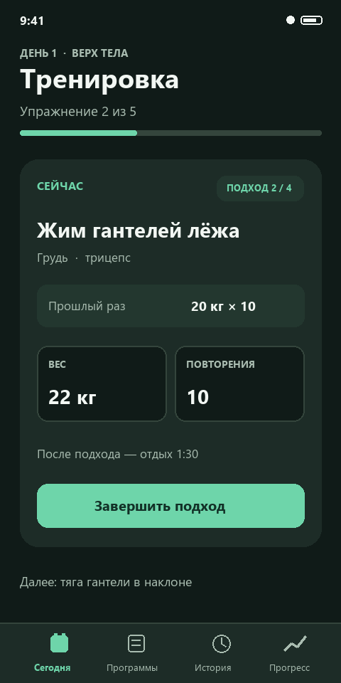
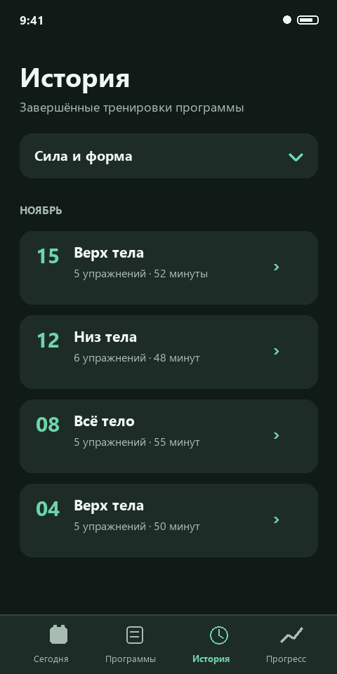
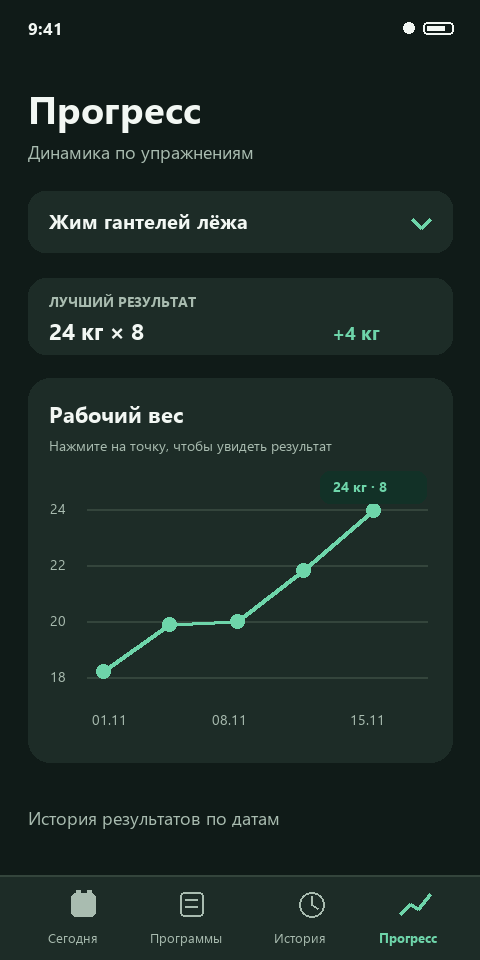

# Workout Logger

**Журнал тренировок для Android.** Составляйте программу, записывайте подходы во время занятия и следите за прогрессом. Данные хранятся на телефоне; для работы не нужен аккаунт или интернет.

[**Скачать APK — версия 1.7.1**](https://github.com/DemaNFox/MyWorkout-Log/releases/latest) · [Все релизы](https://github.com/DemaNFox/MyWorkout-Log/releases)

> APK устанавливается вручную на Android. При обновлении поверх предыдущей версии, подписанной тем же ключом, локальные данные сохраняются. На другой телефон история автоматически не переносится.

## Возможности

- **Программы:** дни, упражнения и целевые подходы в одном месте.
- **Тренировка:** крупный ввод веса и повторений, таймер отдыха и продолжение незавершённого занятия.
- **Прошлые результаты:** последние значения упражнения подставляются в следующую тренировку; результаты из старой программы можно перенести по запросу.
- **История и прогресс:** завершённые занятия и график по датам с показателем выбранной точки.
- **Обмен данными:** импорт программ из JSON и экспорт программ, истории и комментариев.

## Как выглядит приложение

Иллюстрации интерфейса с демонстрационными данными. Они показывают основные экраны, но отдельные детали могут отличаться от текущей сборки.

| Сегодня | Программы | Тренировка |
|:---:|:---:|:---:|
|  |  |  |

| История | Прогресс |
|:---:|:---:|
|  |  |

[Все экраны одним изображением](docs/screenshots/contact-sheet.png)

## Установка

1. Откройте [последний релиз](https://github.com/DemaNFox/MyWorkout-Log/releases/latest).
2. Скачайте `app-release.apk` из раздела **Assets**.
3. Откройте файл на Android и разрешите установку из этого источника, если система попросит.

Приложение работает офлайн и хранит тренировки в локальной SQLite базе. Облачной синхронизации нет. Экспорт `full-backup` пока нельзя восстановить через импорт; для переноса программ используйте [формат импорта программ](docs/program-import.md).

## Для разработчиков

React Native, Expo, TypeScript и SQLite. [Техническое руководство](docs/technical-guide.md) содержит модель данных, команды сборки и проверки. [Справочник упражнений](docs/exercise-dictionary.md) описывает каталог и его идентификаторы.

```bash
npm install
npm run lint
npm run typecheck
npm run test
```

Иллюстрации для README можно пересоздать командой `python scripts/generate_readme_previews.py` после установки Pillow.
